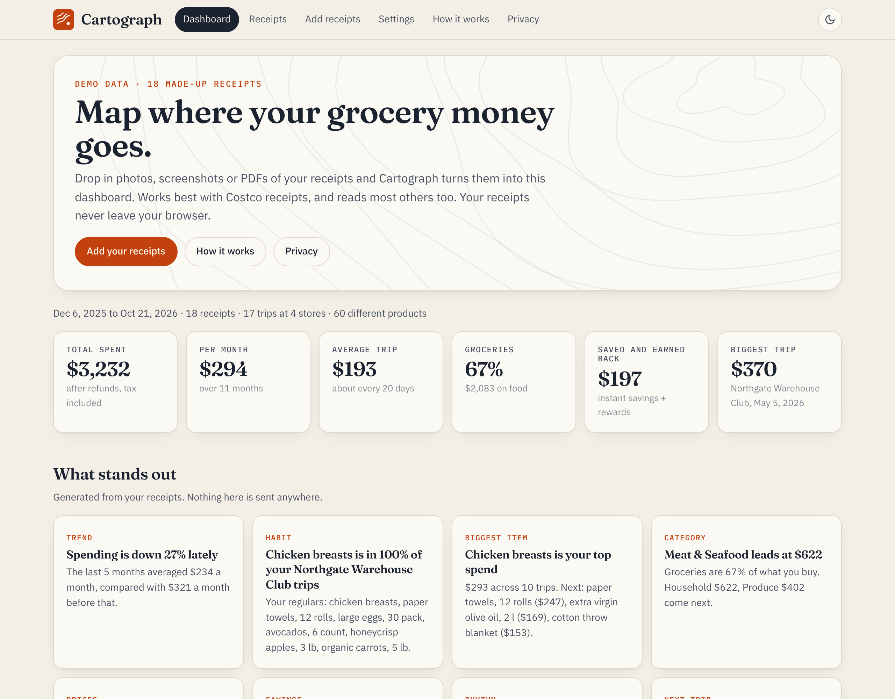

# Cartograph

**Turn grocery receipts into a map of where your money goes.** Drop in photos, screenshots or PDFs of receipts and get a dashboard of your spending: staples, how often you buy them, price changes, what's running low, categories, savings and rewards. Works best with Costco receipts and reads most others too.

**Live app: https://alisoltani7596.github.io/cartograph/** (opens on made-up demo data)

[](https://github.com/alisoltani7596/cartograph/actions/workflows/ci.yml)



## What it does

1. **Read.** Long receipts are cut into tiles at blank rows so small print stays sharp. Then either Claude reads the image with your own Anthropic key, or Tesseract OCR runs in your browser and a rule-based parser reads the text (free, offline, less accurate).
2. **Understand.** Every receipt becomes the same schema: store, location, date, items (printed text, readable name, category, quantity, unit price, line total, discount), instant savings, refunds, tax and total. A store pack turns cryptic lines like `KS GRK YGRT` into "Greek yogurt, Kirkland" and folds instant-savings lines into the item they belong to.
3. **Check.** Each receipt is reconciled: items minus discounts plus tax must equal the printed total, within 2 cents. With Claude, a receipt that doesn't add up is read a second time. Anything still off is flagged and opens in an editable table.
4. **Map.** The dashboard shows KPIs, generated insights, monthly spend, staples and buying frequency, price changes, categories, stores, savings and rewards.

## Privacy model

- **No server stores receipts.** Cartograph is a static site with no backend and no accounts. Parsed receipts live in your browser's IndexedDB. Images and PDFs are read in memory and discarded.
- **Your key, your provider.** The Claude option sends the receipt straight from your browser to `api.anthropic.com` with your own API key. The key stays in the tab (or in IndexedDB if you tick "remember") and is sent nowhere else.
- **Free option stays offline.** The OCR engine and its language data are served from the same site, so nothing leaves your device.
- **Identifiers are stripped before saving.** Membership and loyalty numbers, long digit runs and masked card endings are replaced with X in every saved field.
- **You're in control.** Export and import everything as JSON, or wipe it with one "Delete everything" button.
- No analytics, cookies, ads or third-party fonts and scripts.

## How accurate is it?

Ground truth is 46 real Costco receipts, kept local and never committed. They were split by date: 25 older receipts for development and 21 newer ones (717 item lines) held out as the test set. All prompt tuning, parser fixes, thresholds and the model choice were done on the development half only. The parsers were then frozen and the test set was scored once. The Costco pack only knew item codes seen in the development half, so names and categories on the test set had to be worked out.

**Held-out test set, 21 receipts:**

| Metric | Claude Haiku 5.5, clean | Claude Haiku 5.5, photo | Free OCR, clean | Free OCR, photo |
|---|---:|---:|---:|---:|
| Item lines found with the right price (F1) | 100.0% | 100.0% | 100.0% | 99.8% |
| Discounts matched to the right item | 100.0% | 100.0% | 100.0% | 98.6% |
| Category agrees with hand labels | 93.4% | 92.1% | 77.3% | 77.2% |
| Subtotal, tax, total and date exact | 100.0% | 100.0% | 100.0% | 100.0% |
| Receipts that reconcile | 100.0% | 100.0% | 100.0% | 85.7% |
| Receipts fully correct | 100.0% | 100.0% | 100.0% | 85.7% |
| Cost per receipt | $0.0023 | $0.0020 | free | free |
| Time per receipt (mean) | 10.6 s | 9.3 s | 1.9 s | 1.9 s |

Every OCR receipt with an error failed reconciliation, so mistakes were flagged for review instead of slipping into the dashboard.

**Caveat:** the test images are not phone photos of paper receipts. They were rebuilt from the digital receipt data in the printed warehouse layout; "photo" adds rotation, perspective, uneven light, blur, noise and JPEG compression. Real creased or faded thermal paper will be harder.

### Reproduce it

```bash
npm ci
npm test                    # unit tests
npm run eval:synthetic      # free OCR on the public synthetic set, fails below thresholds
ANTHROPIC_API_KEY=... npm run eval -- --dataset eval/synthetic --method claude --split all --variant photo
```

`eval/synthetic` holds 18 made-up receipts from four fictional stores (warehouse club, grocery, pharmacy, hardware) as ground-truth JSON plus clean and photo-style images. They are the demo data on the landing page and the CI fixtures. A private dataset uses the same layout (`truth/<id>.json`, `images/<variant>/<id>.png|jpg`) and lives outside the repo.

## Develop

```bash
npm ci
npm run dev        # http://localhost:5173/cartograph/
npm run build      # static site in dist/
```

Stack: TypeScript, Vite, Vitest, tesseract.js, pdf.js, idb-keyval. No framework. CI runs type checks, unit tests, the build and the synthetic eval on every push; a second workflow deploys `dist/` to GitHub Pages.

## Adding a store pack

A store pack teaches Cartograph one store's receipts. Packs live in `src/core/packs/`.

1. Create `src/core/packs/mystore.ts` exporting a `StorePack`:

   ```ts
   import type { StorePack } from './index';

   export const MYSTORE_PACK: StorePack = {
     id: 'mystore',
     storeName: 'My Store',
     detect: (text) => /\bmy store\b/i.test(text),
     items: {
       // item code: [printed text, readable name, category]
       '123456': ['ORG BANANAS', 'Organic bananas', 'Produce'],
     },
     rules: [[/^BAG FEE\b/i, 'Bag fee', 'Fees & Deposits']],
     promptHints: 'Item lines end with a tax letter that is not part of the price.',
   };
   ```

2. Add it to `PACKS` in `src/core/packs/index.ts`.
3. If the store prints lines the generic text parser misses, add a case in `src/core/textParser.ts`.
4. Add a few synthetic receipts for the store in `eval/synthetic/generate.ts`, run `npm run synthetic:generate`, render images with `python eval/synthetic/render.py`, and check `npm run eval:synthetic` still passes.

Items not in a pack still get a readable name and a category from the keyword categorizer in `src/core/categorize.ts`.

## License

MIT, see [LICENSE](LICENSE). Not affiliated with Costco or any other store.
